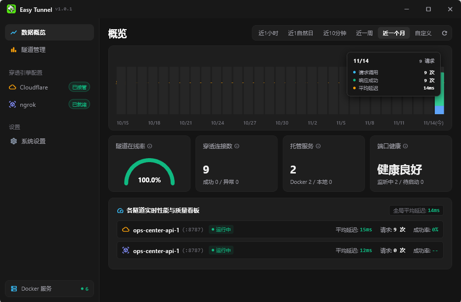
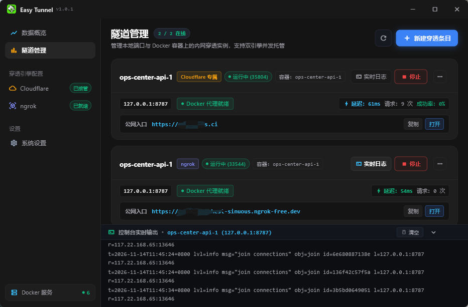
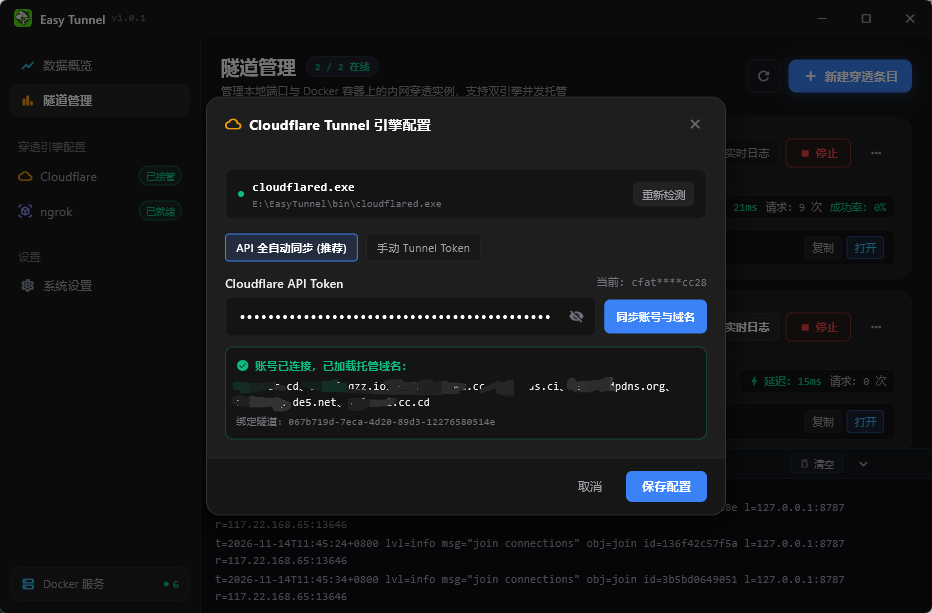
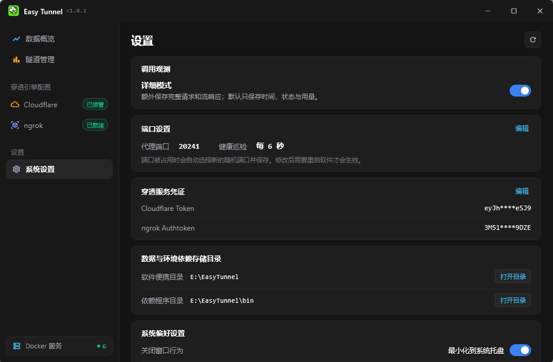

<div align="center">


# Easy Tunnel

### 现代化 Windows 内网穿透与本地端口/容器管理管家

**现代化极致暗黑极简桌面视觉规范**  
*支持 Cloudflare Tunnel 与 ngrok 双引擎并发托管 · Docker 容器智能感知 · 本地端口防误杀释放 · 实时数据观测大屏*

<p align="center">
  <a href="#-实机预览"></a>
  <a href="#-运行平台"></a>
  <a href="https://flutter.dev"></a>
  <a href="LICENSE"></a>
  <a href="CONTRIBUTING.md"></a>
  
</p>

<p align="center">
  <a href="README_EN.md">English</a> •
  <a href="README.md">简体中文</a> •
  <a href="docs/USER_GUIDE.md">用户使用手册</a> •
  <a href="docs/easy-tunnel-design.md">架构设计规范</a> •
  <a href="prototype.html">交互式原型</a>
</p>

</div>

---

## 💡 为什么选择 Easy Tunnel？

在 Windows 开发机上进行本地调试、微信/支付宝等三方 Webhook 回调接收、移动端真机联调或向远程协作同事展示本地服务时，开发者常受限于没有公网 IP。

传统方案通常面临以下痛点：
- **命令行工具分散难用**：`cloudflared` 和 `ngrok` 参数复杂，黑窗口进程容易误关或在后台成为遗留孤儿进程；
- **Docker 容器端口不易排查**：需要频繁 `docker ps` 对照端口与容器名；
- **端口冲突难以释放**：本地旧服务或僵尸进程霸占端口时，需要手动开任务管理器或在 cmd 敲 `netstat -ano` 和 `taskkill`；
- **缺乏调用监控与链路质量**：无法直观获知穿透连接数、响应延迟与请求成功率。

**Easy Tunnel** 为 Windows 开发者量身打造，将双引擎穿透调度、Docker 服务探测、端口监控释放与监控大屏统一收敛到一个轻盈、优雅的原生暗黑桌面客户端中。

---

## 📸 实机预览

| 数据概览监控大屏 | 隧道管理与实时日志抽屉 |
| :---: | :---: |
|  |  |
| *多时间跨度请求趋势、环状在线率仪表盘与延迟看板* | *多隧道独立卡片、延迟/请求统计与控制台输出* |

| Cloudflare 引擎配置与域名同步 | 系统设置与偏好配置 |
| :---: | :---: |
|  |  |
| *API Token 全自动同步已托管域名与绑定的隧道* | *详细日志模式、健康巡检频率、托盘偏好与便携路径* |

---

## ✨ 核心特性

- ⚡ **双穿透引擎并发托管**
  原生集成 **Cloudflare Tunnel (`cloudflared`)** 与 **ngrok**，支持两个引擎同时运行多个穿透条目，一键秒级启停。
- 🐳 **Docker Desktop 智能识别**
  自动侦测宿主机运行中的 Docker 容器与映射端口，新建隧道时在下拉列表中一键带入容器名称与端口，免去繁琐的手动输入。
- 🌐 **双模域名灵活分配**
  - **极速免配模式**：一键分配随机公网二级域名（`*.trycloudflare.com`），即开即用；
  - **私有专属域名模式**：支持 Cloudflare API Token 自动拉取托管域名，绑定私有固定域名（如 `api.yourdomain.com`）。
- 📊 **动态数据概览看板**
  - 半圆形高精度隧道在线率仪表盘；
  - 支持 `近10分钟`、`近1小时`、`近1自然日`、`近一周`、`近一个月` 以及自定义时间维度的请求/延迟趋势柱状图；
  - 各隧道实时性能与质量看板（响应延迟 ms、请求量、成功率）。
- 🛡️ **本地端口健康监控与防误杀释放**
  - 智能区分本地服务与 Docker 容器代理（精准识别 `com.docker.backend.exe`，不误杀正常容器）；
  - 发现异常残留进程占用目标端口时，提供直观的 PID 预警与红色的 **【一键强杀释放】** 按钮（树形强制终结子进程）。
- 🎨 **现代化极简暗黑视觉**
  高质感深色主题（`#0e1013` / `#14161b` / `#181b22`）、紧凑无冗余的单屏卡片布局、平滑呼吸微动效与流畅过渡。
- 🧰 **内置实时控制台日志抽屉**
  集成于隧道卡片下方的极简黑色终端抽屉，支持各隧道日志独立流式展示、关键字色彩高亮（报错红、域名蓝、成功绿）、平滑滚动与一键清空。
- 📦 **纯绿色便携自包含 & 极速安装包**
  - **便携模式**：配置保存在同级 `data/`，二进制存放在 `bin/`，随拷随走，换电脑无缝继承；
  - **独立安装包**：单文件 C# 安装向导，无需管理员 UAC 权限，无损覆盖升级绝不破坏已有配置。
- 🔔 **系统托盘后台静默与退出安全**
  关闭窗口时可选最小化到任务栏右下角小托盘，后台保持不断连；彻底退出时自动级联销毁所有衍生子进程，**绝对零幽灵进程残留**。

---

## 🏗️ 总体架构

Easy Tunnel 采用 **Flutter Windows 原生单进程托管架构**，无需复杂的常驻 Windows Service，确保分发极简、内存占用极低（< 50MB）且生命周期高度可控。

```
┌────────────────────────────────────────────────────────────────────────┐
│                          Flutter UI 表现层                              │
│   [数据概览大屏]      [多隧道卡片管理]      [系统偏好设置]     [日志抽屉]   │
└───────────────────────────────────┬────────────────────────────────────┘
                                    │ Riverpod / Provider 响应式状态流
┌───────────────────────────────────▼────────────────────────────────────┐
│                           业务服务层 (Services)                         │
│  - DockerService: 容器巡检与端口映射探测                                  │
│  - TunnelEngine / Manager: cloudflared & ngrok 进程生命周期与输出流解析  │
│  - CloudflareApiService: 账号 Token 校验与托管域名全自动拉取              │
│  - PortMonitorService: 本地端口监听探测、Docker 防误杀与一键 taskkill    │
│  - StorageService: 本地/便携式持久化存储 (config.json)                   │
│  - DependencyService: 穿透二进制自检、版本比对与下载初始化                 │
└───────────────────────────────────┬────────────────────────────────────┘
                                    │ 异步进程管理 (dart:io Process)
┌───────────────────────────────────▼────────────────────────────────────┐
│                         底层进程与系统命令执行                           │
│   cloudflared.exe (Tunnel)  │  ngrok.exe (Tunnel)  │  docker.exe (CLI) │
│   netstat -ano (端口探测)    │  taskkill /F /T (释放) │  curl / API 探测  │
└───────────────────────────────────┬────────────────────────────────────┘
                                    │ 平台原生通道 (Win32 API)
┌───────────────────────────────────▼────────────────────────────────────┐
│                        Windows 桌面系统集成层                           │
│   tray_manager (系统托盘驻留)       │   window_manager (窗口尺寸与生命周期)│
└────────────────────────────────────────────────────────────────────────┘
```

---

## 🚀 快速上手

### 方式一：下载 Windows 独立安装包（推荐）

1. 从 [Releases 页面](https://github.com/c898398828/easy_tunnel/releases) 下载最新的 `EasyTunnel-Setup-v1.0.1.exe`；
2. 双击运行安装向导（默认安装至用户目录 `%LOCALAPPDATA%\Programs\EasyTunnel`，**无需管理员 UAC 权限**）；
3. 安装完成后自动在开始菜单和桌面生成快捷方式，打开即可使用；
4. 首次启动软件会自动检测并准备 `cloudflared` 与 `ngrok` 依赖环境。

> 💡 **无损升级保证**：后续下载新版本安装包直接运行即可，安装向导会自动退出旧版本并无缝替换程序文件，**绝不会删除或修改你的自定义隧道配置和 Token**。

### 方式二：纯绿色便携运行（免安装）

1. 下载便携发布包解压至任意目录（例如 `D:\Tools\EasyTunnel` 或 U 盘）；
2. 双击 `easy_tunnel.exe` 启动；
3. 便携模式下所有配置文件保存在 `data/config.json`，依赖二进制保存在 `bin/`，随拷随用。

---

## 🛠️ 从源码构建

### 前置要求
- **操作系统**：Windows 10 / Windows 11 (x64)
- **Flutter SDK**：`>= 3.24.0`（需开启桌面支持：`flutter config --enable-windows-desktop`）
- **Visual Studio**：Visual Studio 2022（需勾选“使用 C++ 的桌面开发”工作负载）
- **.NET Framework 4.0+**（用于编译单文件 C# 安装包，Windows 自带）

### 编译 Flutter 桌面应用
```powershell
# 1. 克隆代码仓库
git clone https://github.com/c898398828/easy_tunnel.git
cd easy_tunnel\app

# 2. 安装依赖并执行代码静态检查
flutter pub get
flutter analyze

# 3. 运行本地单元测试
flutter test --no-pub

# 4. 调试模式启动
flutter run -d windows

# 5. 编译生产 Release 二进制
flutter build windows --release
# 输出目录: app\build\windows\x64\runner\Release\
```

### 编译单文件 Windows 安装包
在完成 Release 构建后，运行安装程序打包脚本：
```powershell
cd easy_tunnel\installer
.\build_installer.ps1
# 输出安装包: easy_tunnel\dist\EasyTunnel-Setup-v1.0.1.exe
```

---

## 📁 目录结构

```
easy_tunnel/
├── .github/                      # GitHub 规范配置与 CI/CD 流水线
│   ├── ISSUE_TEMPLATE/           # Bug 反馈与 Feature 建议模版
│   ├── PULL_REQUEST_TEMPLATE.md  # 标准 PR 提交模版
│   └── workflows/
│       ├── ci.yml                # 代码静态检查与自动化单元测试
│       └── release.yml           # 打 Tag 自动编译并发布 GitHub Release
├── app/                          # Flutter Windows 桌面端完整源码
│   ├── assets/                   # 应用高清 Logo 与系统托盘图标
│   ├── lib/
│   │   ├── models/               # 隧道配置与数据模型
│   │   ├── providers/            # Riverpod / 状态管理
│   │   ├── services/             # Docker、进程、端口监测与存储服务
│   │   ├── ui/                   # 页面与组件（仪表盘、隧道列表、设置）
│   │   │   └── widgets/          # 监控图表、性能看板、状态卡片、日志抽屉等
│   │   ├── app.dart              # 主应用结构
│   │   ├── main.dart             # 程序入口与托盘初始化
│   │   └── theme.dart            # 极简暗黑主题规范定义
│   ├── test/                     # 完整的服务与逻辑单元测试集
│   ├── windows/                  # Windows 原生 C++ Runner 与资源清单
│   └── pubspec.yaml              # Flutter 项目依赖配置
├── dist/                         # 安装包输出目录（受 .gitignore 保护）
│   └── .gitkeep
├── docs/                         # 项目技术文档与素材资源
│   ├── images/                   # 实机截图高清图片资源
│   ├── USER_GUIDE.md             # 用户保姆级使用与排错说明书 (必读)
│   ├── easy-tunnel-design.md     # 架构设计与技术选型规范
│   ├── implementation-plan.md    # 完整实施落地计划
│   └── conversation-record.md    # 方案演进与架构设计详录
├── installer/                    # Windows 独立安装向导构建工具
│   ├── Setup.cs                  # 基于 WinForms 的轻量级单文件安装程序源码
│   ├── build_installer.bat       # Windows 批处理一键打包脚本
│   └── build_installer.ps1       # PowerShell 安装包打包编译脚本
├── .gitignore                    # 规范的 Git 忽略规则 (过滤构建物与敏感配置)
├── CODE_OF_CONDUCT.md            # 社区贡献者行为准则 (Contributor Covenant v2.1)
├── CONTRIBUTING.md               # 开源贡献指南 (开发调试、代码规范与 PR 流程)
├── LICENSE                       # Apache 2.0 开源许可协议
├── prototype.html                # Windows Desktop 极简暗黑交互式原型页面
├── README.md                     # 项目主页文档 (中文)
├── README_EN.md                  # 项目主页文档 (English)
├── SECURITY.md                   # 安全政策与漏洞披露流程
└── start-tunnel.sh               # 原始 Linux 双穿透后端管理脚本 (参考逻辑)
```

---

## 📖 文档导航

- 📘 **[用户完整使用指南 (USER_GUIDE.md)](docs/USER_GUIDE.md)**：包含 Cloudflare Zero Trust 域名绑定教程、ngrok 配置、Docker 联动与常见 FAQ 排错。
- 📐 **[系统架构设计规范 (easy-tunnel-design.md)](docs/easy-tunnel-design.md)**：深入了解 Windows 进程树生命周期管控、防误杀算法与数据模型。
- 🖥️ **[交互式原型 (prototype.html)](prototype.html)**：双击即可在浏览器中体验纯前端的高保真暗黑界面交互原型。

---

## 🤝 参与贡献

我们非常欢迎社区开发者的贡献！
无论是修复 Bug、完善文档、改进 UI 细节还是新增穿透协议支持，都可以按照以下步骤参与：

1. 查阅 [CONTRIBUTING.md](CONTRIBUTING.md) 了解代码规范与分支流程；
2. 遵守 [CODE_OF_CONDUCT.md](CODE_OF_CONDUCT.md) 社区行为准则；
3. 发现安全漏洞请参阅 [SECURITY.md](SECURITY.md) 进行私密披露。

---

## 📄 开源许可

本项目基于 [Apache License 2.0](LICENSE) 协议开源。商业友好，保留版权即可自由使用、修改与分发。
