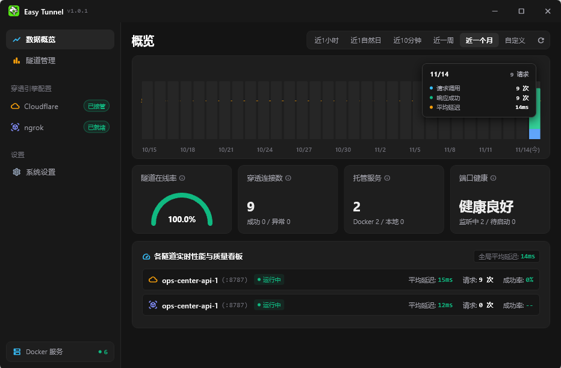
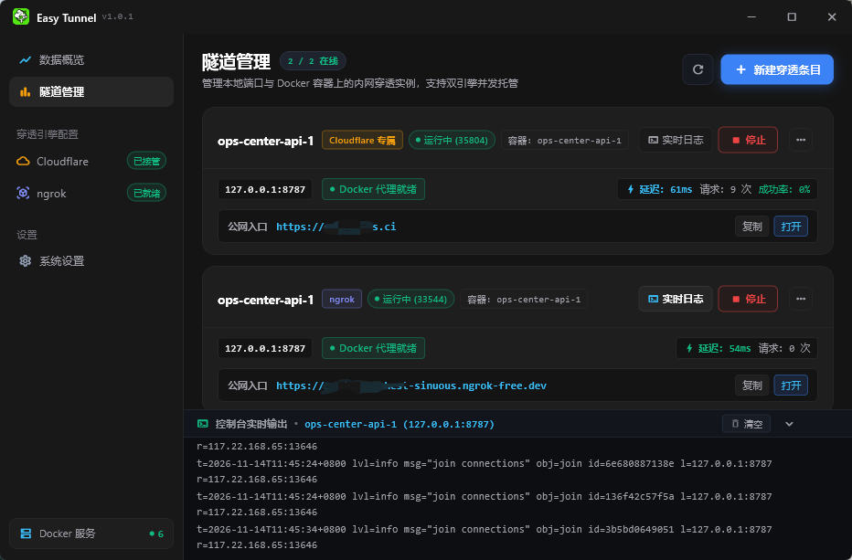
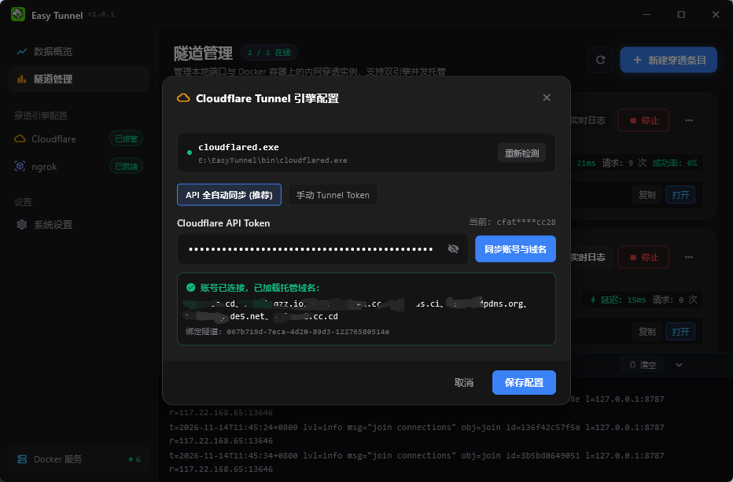
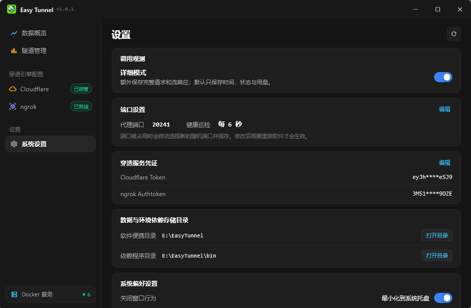

<div align="center">


# Easy Tunnel

### Modern Windows Local Tunneling & Container Port Manager

**Modern Dark Minimalist Desktop Aesthetic**  
*Dual-Engine Concurrent Tunneling (Cloudflare Tunnel + ngrok) · Docker Container Awareness · Port Conflict Resolution · Real-time Metrics Dashboard*

<p align="center">
  <a href="#-screenshots"></a>
  <a href="#-supported-platforms"></a>
  <a href="https://flutter.dev"></a>
  <a href="LICENSE"></a>
  <a href="CONTRIBUTING.md"></a>
  
</p>

<p align="center">
  <a href="README_EN.md">English</a> •
  <a href="README.md">简体中文</a> •
  <a href="docs/USER_GUIDE.md">User Guide (CN)</a> •
  <a href="docs/easy-tunnel-design.md">Architecture Spec</a> •
  <a href="prototype.html">Interactive Prototype</a>
</p>

</div>

---

## 💡 Why Easy Tunnel?

When debugging local web applications, testing webhook callbacks (WeChat, Stripe, GitHub, etc.), conducting real-device mobile testing, or demoing prototypes to remote clients on a Windows PC, developers frequently struggle with the lack of a public IP address.

Traditional solutions present frequent headaches:
- **Dispersed and cumbersome CLI flags**: Juggling `cloudflared` and `ngrok` commands often leads to accidental window closes or lingering zombie processes;
- **Docker port mapping hassles**: Constantly running `docker ps` to cross-reference host ports with container names;
- **Stubborn port locks**: Stale development servers or ghost processes occupy desired ports, requiring manual Task Manager lookups or `netstat -ano` / `taskkill` commands;
- **Zero visibility into metrics**: No simple way to check connection latency, request counts, or success rates.

**Easy Tunnel** is built specifically for Windows developers, combining dual-engine tunnel orchestration, automatic Docker service discovery, port conflict resolution, and real-time observability into one sleek, dark desktop client.

---

## 📸 Screenshots

| Overview & Metrics Dashboard | Tunnel Management & Live Console |
| :---: | :---: |
|  |  |
| *Multi-interval request trend, gauge uptime meter, and latency boards* | *Individual tunnel cards, latency/traffic counters, and live console drawer* |

| Cloudflare Engine & Domain Sync | System Settings & Credentials |
| :---: | :---: |
|  |  |
| *Automatic API token sync for managed domains and bound tunnels* | *Detailed log toggles, health check frequency, and tray preferences* |

---

## ✨ Key Features

- ⚡ **Dual-Engine Concurrent Tunneling**
  Natively integrates **Cloudflare Tunnel (`cloudflared`)** and **ngrok**. Run multiple tunnels simultaneously across different engines with one-click toggles.
- 🐳 **Smart Docker Desktop Awareness**
  Automatically probes active Docker containers and their mapped ports. Select any container from a dropdown when creating a tunnel to auto-fill its host port and name.
- 🌐 **Flexible Dual-Mode Domains**
  - **Quick Zero-Config Mode**: Instant temporary public URL (`*.trycloudflare.com`), zero registration needed;
  - **Custom Branded Domains**: Sync owned domains via Cloudflare API Token for persistent, production-grade custom subdomains (`api.yourdomain.com`).
- 📊 **Dynamic Observability Dashboard**
  - Smooth semi-circular tunnel uptime gauge;
  - Interactive request volume and latency charts across multiple time horizons (`10 Minutes`, `1 Hour`, `1 Day`, `1 Week`, `1 Month`, and `Custom`);
  - Per-tunnel latency (ms), request counter, and success rate tracking.
- 🛡️ **Port Conflict Detection & Safe Killing**
  - Smart recognition of genuine services vs. Docker Desktop proxies (`com.docker.backend.exe` is never misdiagnosed as a conflict);
  - Direct PID alerts and a red **【Kill Process】** button (`taskkill /F /T`) to safely release locked ports.
- 🎨 **Modern Dark Minimalist Aesthetic**
  Ultra-clean, dark aesthetic (`#0e1013` / `#14161b` / `#181b22`) with smooth transitions and compact single-screen layout.
- 🧰 **Embedded Live Console Drawer**
  Integrated terminal console drawer at the bottom. Streams live logs per tunnel with syntax-colored keywords (red errors, cyan URLs, green connections).
- 📦 **Zero-Dependency Portable Mode & Native Installer**
  - **Portable Mode**: Configuration stored in adjacent `data/` and binaries in `bin/`—ready to run off a USB drive;
  - **Single-File Setup Wizard**: Built with C# WinForms, installs to user `%LOCALAPPDATA%` without requiring admin UAC prompts, with lossless in-place upgrade capabilities.
- 🔔 **System Tray Daemon & Clean Exit**
  Minimize to the Windows system tray with zero background disruption; completely terminates child processes upon app exit with **zero orphaned processes**.

---

## 🏗️ Architecture

Easy Tunnel follows a **Flutter Windows native process hosting architecture**, avoiding heavy background Windows Services while keeping memory footprint under 50MB.

```
┌────────────────────────────────────────────────────────────────────────┐
│                        Flutter UI Presentation Layer                    │
│   [Metrics Dashboard]    [Tunnel Card Manager]    [Settings]   [Console]│
└───────────────────────────────────┬────────────────────────────────────┘
                                    │ Riverpod / Provider State Streams
┌───────────────────────────────────▼────────────────────────────────────┐
│                           Service Layer                                 │
│  - DockerService: Container inspection & port mapping detection        │
│  - TunnelEngine / Manager: cloudflared & ngrok process lifecycles       │
│  - CloudflareApiService: Account verification & domain sync             │
│  - PortMonitorService: Local socket inspection & smart taskkill        │
│  - StorageService: Local and portable configuration persistence        │
│  - DependencyService: Engine binary self-check and auto-downloader     │
└───────────────────────────────────┬────────────────────────────────────┘
                                    │ Async Subprocesses (dart:io Process)
┌───────────────────────────────────▼────────────────────────────────────┐
│                    Underlying System & CLI Processes                   │
│   cloudflared.exe (Tunnel)  │  ngrok.exe (Tunnel)  │  docker.exe (CLI) │
│   netstat -ano (Sockets)    │  taskkill /F /T      │  curl / WinHTTP   │
└───────────────────────────────────┬────────────────────────────────────┘
                                    │ Platform Channels (Win32 API)
┌───────────────────────────────────▼────────────────────────────────────┐
│                      Windows Desktop Integration                       │
│   tray_manager (System Tray)        │   window_manager (Window Control)│
└────────────────────────────────────────────────────────────────────────┘
```

---

## 🚀 Quick Start

### Option 1: Standalone Windows Installer (Recommended)

1. Download `EasyTunnel-Setup-v1.0.1.exe` from [Releases](https://github.com/c898398828/easy_tunnel/releases);
2. Run the installer (installs to `%LOCALAPPDATA%\Programs\EasyTunnel`, **no admin rights needed**);
3. Start the application via Desktop or Start Menu shortcuts;
4. On first run, required binaries (`cloudflared` and `ngrok`) will be initialized automatically.

> 💡 **Lossless In-Place Upgrade**: Upgrades overwrite only application binaries without ever touching your configured tunnels or saved tokens in `%APPDATA%\dev.easytunnel\config.json`.

### Option 2: Portable Mode

1. Extract the release zip to any directory (e.g., `D:\Tools\EasyTunnel`);
2. Run `easy_tunnel.exe`;
3. All configs and binaries reside within the directory (`data/` and `bin/`).

---

## 🛠️ Build from Source

### Prerequisites
- **OS**: Windows 10 / Windows 11 (x64)
- **Flutter SDK**: `>= 3.24.0` (with desktop enabled: `flutter config --enable-windows-desktop`)
- **Visual Studio**: Visual Studio 2022 (with "Desktop development with C++" workload)
- **.NET Framework 4.0+** (included with Windows, used by the installer compiler)

### Build Flutter Desktop App
```powershell
# 1. Clone repository
git clone https://github.com/c898398828/easy_tunnel.git
cd easy_tunnel\app

# 2. Fetch packages & analyze
flutter pub get
flutter analyze

# 3. Run unit tests
flutter test --no-pub

# 4. Launch in debug mode
flutter run -d windows

# 5. Build release binary
flutter build windows --release
# Output: app\build\windows\x64\runner\Release\
```

### Build Windows Installer
Once the Flutter release build completes:
```powershell
cd easy_tunnel\installer
.\build_installer.ps1
# Output: easy_tunnel\dist\EasyTunnel-Setup-v1.0.1.exe
```

---

## 📁 Repository Structure

```
easy_tunnel/
├── .github/                      # GitHub configurations & CI/CD workflows
│   ├── ISSUE_TEMPLATE/           # Bug report & feature request templates
│   ├── PULL_REQUEST_TEMPLATE.md  # Standard pull request template
│   └── workflows/
│       ├── ci.yml                # Automated lint & unit testing on Windows
│       └── release.yml           # Automatic installer builder on Git tags
├── app/                          # Complete Flutter Windows desktop source code
│   ├── assets/                   # Logos, app icons, and tray graphics
│   ├── lib/
│   │   ├── models/               # Tunnel models & config serializations
│   │   ├── providers/            # State management & event buses
│   │   ├── services/             # Docker, process, port monitor & storage
│   │   ├── ui/                   # Pages (Dashboard, Tunnels, Settings)
│   │   │   └── widgets/          # Charts, metric tiles, cards, log drawer
│   │   ├── app.dart              # Root application widget
│   │   ├── main.dart             # Program entrypoint & tray init
│   │   └── theme.dart            # Dark theme design tokens
│   ├── test/                     # Service & model unit test suites
│   ├── windows/                  # Windows C++ runner & manifests
│   └── pubspec.yaml              # Flutter dependency manifest
├── dist/                         # Installer artifacts (.gitignore protected)
│   └── .gitkeep
├── docs/                         # Documentation & assets
│   ├── images/                   # High-res UI screenshots
│   ├── USER_GUIDE.md             # Complete user guide & troubleshooting (CN)
│   ├── easy-tunnel-design.md     # Architectural specification
│   ├── implementation-plan.md    # Detailed roadmap & execution steps
│   └── conversation-record.md    # Technical evolution record
├── installer/                    # Windows installer build system
│   ├── Setup.cs                  # Lightweight C# WinForms installer wizard
│   ├── build_installer.bat       # One-click Windows batch script
│   └── build_installer.ps1       # PowerShell installer build script
├── .gitignore                    # Clean Git ignore rules
├── CODE_OF_CONDUCT.md            # Contributor Covenant v2.1
├── CONTRIBUTING.md               # Contribution guidelines & dev guide
├── LICENSE                       # Apache License 2.0
├── prototype.html                # Interactive HTML5 dark theme prototype
├── README.md                     # Flagship README (Chinese)
├── README_EN.md                  # Flagship README (English)
├── SECURITY.md                   # Security vulnerability reporting policy
└── start-tunnel.sh               # Reference Linux shell script
```

---

## 🤝 Contributing

Contributions are welcome and appreciated!
- Follow our [CONTRIBUTING.md](CONTRIBUTING.md) for development setup and PR guidelines;
- Adhere to the [CODE_OF_CONDUCT.md](CODE_OF_CONDUCT.md);
- Report security issues via [SECURITY.md](SECURITY.md).

---

## 📄 License

Licensed under the [Apache License, Version 2.0](LICENSE).
