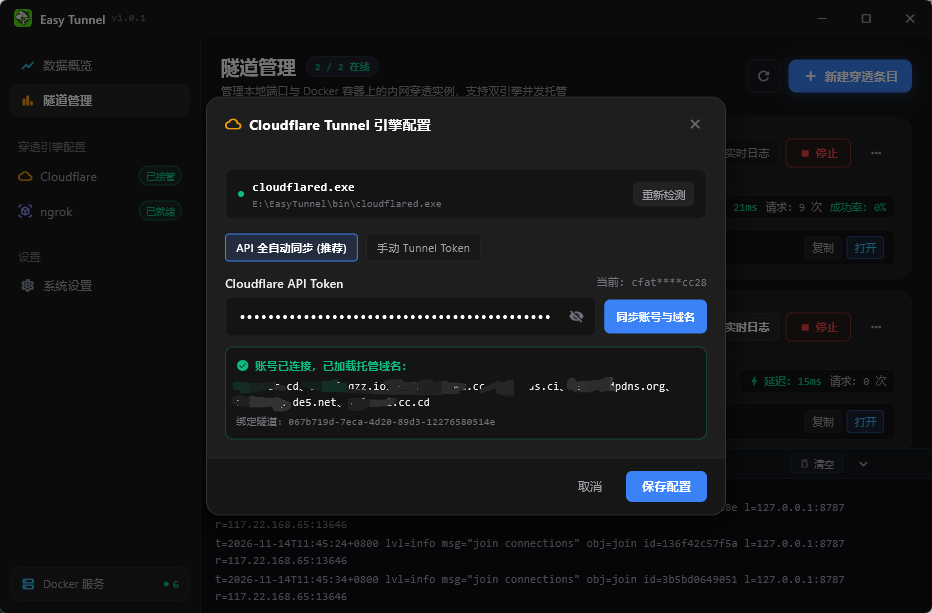
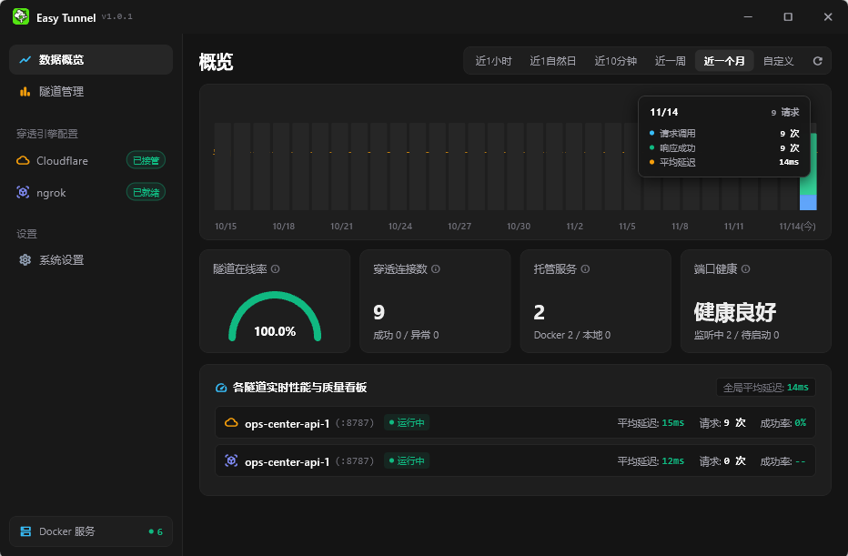
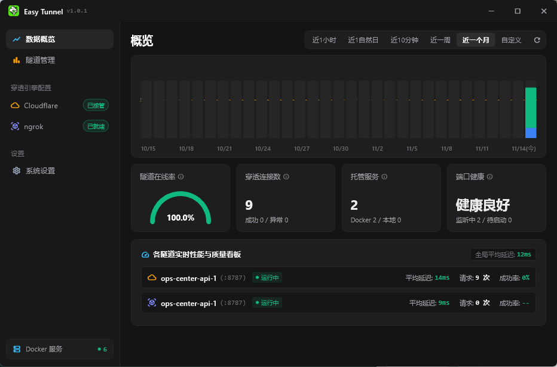
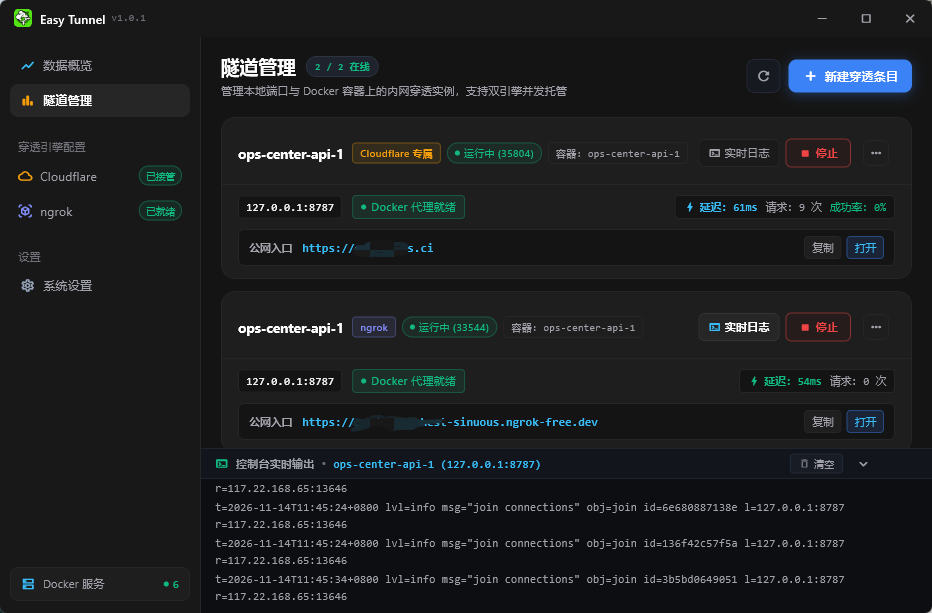
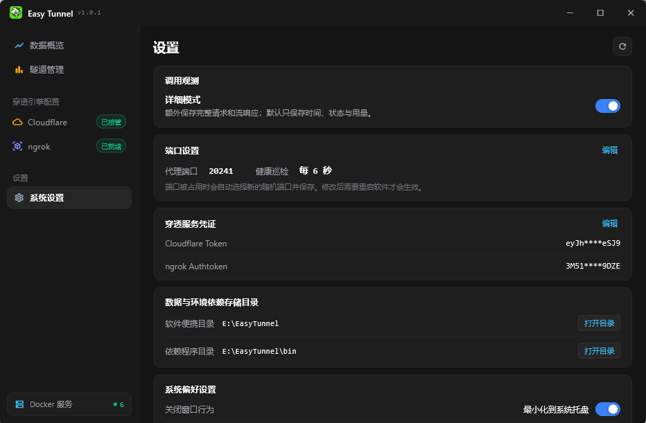

# Easy Tunnel 助手 - 官方用户使用说明文档

> **版本**：v1.0.1  
> **适用平台**：Windows 10 / Windows 11 (x86_64)  
> **定位**：专为 Windows 开发机打造的现代化内网穿透与端口管理桌面工具，支持 Docker 容器智能识别、多隧道并发穿透、域名自动分配以及端口冲突智能释放。

---

## 目录

- [一、 产品简介与核心特性](#一-产品简介与核心特性)
- [二、 安装、升级与便携运行](#二-安装升级与便携运行)
- [三、 快速上手：一分钟开启内网穿透](#三-快速上手一分钟开启内网穿透)
  - [3.1 极速免配模式（零配置、即开即用）](#31-极速免配模式零配置即开即用)
  - [3.2 Cloudflare 专属自定义域名（绑定自有域名，稳定长期托管）](#32-cloudflare-专属自定义域名绑定自有域名稳定长期托管)
  - [3.3 ngrok 穿透配置](#33-ngrok-穿透配置)
- [四、 核心功能深度解析](#四-核心功能深度解析)
  - [4.1 Docker 容器智能扫描与回填](#41-docker-容器智能扫描与回填)
  - [4.2 本地端口监控与防误杀机制](#42-本地端口监控与防误杀机制)
  - [4.3 动态数据概览大屏与多尺度切换](#43-动态数据概览大屏与多尺度切换)
  - [4.4 实时控制台日志抽屉](#44-实时控制台日志抽屉)
  - [4.5 侧边栏独立引擎配置弹窗](#45-侧边栏独立引擎配置弹窗)
- [五、 系统设置与偏好配置](#五-系统设置与偏好配置)
- [六、 常见问题与排错指南 (FAQ)](#六-常见问题与排错指南-faq)

---

## 一、 产品简介与核心特性

在 Windows 开发机上调试本地后端接口、微信小程序/支付宝 Webhook 回调、移动端真机联调或向远程客户临时展示本地服务时，经常受限于没有公网 IP。

传统命令行脚本操作复杂、依赖 Linux 命名空间、且难以直观排查端口占用与日志输出。**Easy Tunnel 助手** 彻底解决了这些痛点：

* **双穿透引擎驱动**：深度集成 **Cloudflare Tunnel (`cloudflared`)** 与 **ngrok**，一键拉起与热切换；
* **双模域名支持**：既支持零配置的临时随机公网域名（`*.trycloudflare.com`），又支持绑定私有专属二级域名；
* **Docker 智能识别**：自动探测本机正在运行的 Docker 容器和宿主机映射端口，下拉一键回填；
* **免 Docker 兼容**：纯本地启动的 Vite、Vue、Next.js、Spring Boot、Python、Go 等任意端口均可一键映射；
* **智能端口监控与防误杀**：精准区分 Docker 正常代理服务与真正的残留僵尸进程，绝不误杀正在运行的开发服务器；
* **现代化暗黑极简视觉**：采用纯正暗黑桌面规范，配备紧凑型单屏布局、半圆形平滑仪表盘与多尺度动态图表；
* **绿色便携自包含**：所有数据与下载的依赖程序均优先存放在软件解压目录内，零 C 盘垃圾污染；
* **托盘常驻与生命周期安全**：支持最小化至任务栏右下角小托盘后台静默运行，软件彻底退出时自动级联终止所有子进程，绝无幽灵进程残留。

---

## 二、 安装、升级与便携运行

软件提供两种运行与部署方式，用户可根据自身使用习惯自由选择：

### 2.1 方式一：独立现代安装包（推荐）
- **安装包路径**：`easy_tunnel/dist/EasyTunnel-Setup-v1.0.1.exe`
- **特点**：
  - **无需管理员 UAC 权限**：默认安装至用户程序目录 `%LOCALAPPDATA%\Programs\EasyTunnel`；
  - **自动系统集成**：在桌面和开始菜单自动创建高清图标快捷方式，并注册到 Windows 11 “已安装的应用”；
  - **无损覆盖升级**：后续发布新版本时，直接运行新版安装包，程序会自动退出旧版并安全替换主程序，**绝对不会删除或修改你的隧道配置与 Token 凭据**！

### 2.2 方式二：纯绿色便携运行（免安装）
- 直接将编译产物目录（包含 `easy_tunnel.exe`）拷贝到任意盘符（如 `D:\Tools\EasyTunnel` 或 U 盘）；
- 双击 `easy_tunnel.exe` 即可直接运行。
- **便携模式优势**：软件的配置文件将保存在同级 `data/config.json`，下载的穿透二进制保存在同级 `bin/`，随拷随走，换电脑只需整包复制即可继承全部配置。

---

## 三、 快速上手：一分钟开启内网穿透

### 3.1 极速免配模式（零配置、即开即用）
适用于临时联调、第三方 Webhook 回调测试或给远程同事临时看效果。

1. 点击左侧菜单【隧道管理】，点击右上角【+ 新建穿透条目】；
2. **输入本地端口**：
   - 如果是 Docker 服务：在下拉菜单中直接选中正在运行的容器（例如 `ops-center-api-1:8787`），端口与名称将自动带入；
   - 如果是本地代码直接运行（如 `localhost:3000`）：直接在端口框输入 `3000`；
3. **穿透服务商**：保持默认勾选 `Cloudflare`；
4. **域名分配**：保持默认勾选 `自动随机分配 (免配置)`；
5. 点击【保存并加入】；
6. 在列表中找到新建的卡片，点击【启动】：
   - 几秒钟后，卡片上的状态灯变为绿色 `运行中`；
   - 卡片上会高亮显示生成的公网入口（如 `https://rapid-alpine-tunnel.trycloudflare.com`）；
   - 点击右侧【复制】即可复制链接发给同事，或点击【打开】直接在浏览器中访问！

---

### 3.2 Cloudflare 专属自定义域名（绑定自有域名，稳定长期托管）
适用于需要用自己的专属域名（例如 `api.yourcompany.com`）长期稳定对外提供服务。

#### 第一步：在 Cloudflare 后台创建 Tunnel 并复制 Token
1. 登录 [Cloudflare Zero Trust 仪表盘](https://one.dash.cloudflare.com/)（确保你的域名已经在 Cloudflare 托管）；
2. 依次点击左侧菜单：**Networks** $\rightarrow$ **Tunnels**；
3. 点击 **Add a tunnel** $\rightarrow$ 选择 **Cloudflare** $\rightarrow$ 随便输入一个隧道名称（如 `office-dev`）$\rightarrow$ 点击 **Save tunnel**；
4. 在接下来的安装说明页面中，找到命令里的 `--token eyJh...`，**复制这一串长长的 Token 字符串**。

#### 第二步：在 Cloudflare 后台配置域名路由（Public Hostname）
在刚创建好的 Tunnel 详情页中，点击顶部的 **Public Hostname** 标签页：
- 点击 **Add a public hostname**：
  - **Subdomain**：填你想要的二级前缀（例如 `api`）；
  - **Domain**：下拉选择你已托管的主域名（例如 `yourcompany.com`）；
  - *(此时拼接出的对外完整地址就是 `api.yourcompany.com`)*；
  - **Type**：保持默认的 `HTTP`；
  - **URL**：填入你本机服务的内部端口，例如 `localhost:8787`；
- 点击右下角 **Save hostname** 保存完成。

#### 第三步：在 Easy Tunnel 中配置并启动
1. 在 Easy Tunnel 软件左侧导航栏，点击 **Cloudflare**（旁边有绿色“已接管”微标）；
2. 在弹出的配置窗口中，将第一步复制的 Token 粘贴进输入框，点击【保存凭据】；
3. 点击右上角【+ 新建穿透条目】：
   - 端口填入你的本地端口（如 `8787`）；
   - 穿透服务商选择 `Cloudflare`；
   - 域名分配选择 **`专属自定义域名`**；
   - 输入框填入你在第二步配好的完整域名（如 `api.yourcompany.com`）；
4. 点击【保存并加入】，在卡片上点击【启动】！
   - 隧道启动就绪后，公网地址将锁定为你的专属域名，全球任何网络均可通过 `https://api.yourcompany.com` 直连你的本地开发机！

---

### 3.3 ngrok 穿透配置
1. 登录 [ngrok 官网控制台](https://dashboard.ngrok.com/)，在 **Your Authtoken** 复制你的个人 Token；
2. 在 Easy Tunnel 侧边栏点击 **ngrok**，粘贴保存 Token；
3. 在新建穿透时服务商选择 `ngrok`：
   - 选“自动随机分配”：每次启动自动获取随机 `*.ngrok-free.app` 二级域名；
   - 选“专属自定义域名”：填入你在 ngrok 免费 Claim 的固定二级域名（如 `my-dev.ngrok-free.app`）。

---

## 四、 核心功能深度解析

### 4.1 Docker 容器智能扫描与回填
- 软件内置了智能 Docker 探测器（调用 `docker ps`），每 15 秒自动巡检一次宿主机容器状态；
- 在新建隧道时，下拉框会实时列出所有映射了端口的在线容器（格式：`容器名:映射端口`）；
- 选中即可一键带入端口与默认隧道名称，省去手动在命令行打 `docker ps` 查看端口映射的麻烦。

### 4.2 本地端口监控与防误杀机制
Windows 开发者最常遇到的痛点就是端口冲突或被后台进程死锁。Easy Tunnel 提供了多级智能状态识别：

| 状态呈现 | 背后实际情况 | 软件应对策略 |
| :--- | :--- | :--- |
| **🟢 本地端口监听正常** | 隧道处于运行中，本地服务正常响应 | 链路通畅，随时可以通过公网地址访问。 |
| **🟢 容器服务监听中 (Docker 代理就绪)** | 端口已被 Docker Desktop（`com.docker.backend.exe`）正常代理 | **精准识别 Docker 特征，绝不误判冲突，不显示强杀按钮**，服务处于健康就绪状态。 |
| **🟢 本地服务已就绪: node.exe** | 端口已被本地开发进程（如 Vite/Python）正常监听 | 提示本地程序已准备好，点击启动即可直接穿透。 |
| **⚪ 端口空闲 (待本地服务启动)** | 端口当前没有任何程序监听 | 提醒开发者先启动本地工程，然后再开穿透。 |
| **⚠️ 残留隧道占用 (PID: xxxx)** | 隧道已停止，但端口被此前未正常退出的 `cloudflared.exe` 或 `ngrok.exe` 占用 | 触发黄色预警，并亮起红色的 **【强杀释放】** 按钮。点击后自动执行 `taskkill /F /T` 树形强制释放，无需打开任务管理器。 |

### 4.3 动态数据概览大屏与多尺度切换
- **现代化暗黑桌面设计**：暗黑质感、半圆形速度计弧线仪表盘（实时反应当前隧道在线比率）；
- **动态交互柱状图**：
  - 平时保持极简纯净的等高深灰背景槽（完全杜绝遮挡）；
  - 当鼠标滑过柱子时，动态悬浮卡片平滑跟随，实时展示当日的直连转发、边缘响应与出站流量；

- **多尺度时间范围切换**：
  - 点击顶部胶囊项（`近10分钟` / `近1小时` / `近1自然日` / `近一周` / `近一个月`），柱状图内部采用平滑生长动画实时刷新时段刻度与活跃高度；
  - 点击 **【自定义】** 时，平滑呼出暗黑悬浮面板，支持快捷选择 `近4小时` / `近24小时` 或手动选择起止时段。

### 4.4 实时控制台日志抽屉
- 在【隧道管理】页面下方内嵌了终端级控制台日志抽屉；
- 点击任意卡片上的【实时日志】按钮，抽屉自动滑出并聚焦该隧道的实时输出；
- **智能日志滚动**：新日志到达时自动滚动到底部；若用户正在往上滚动翻看历史记录，系统不会粗暴拽回；
- **关键字色彩高亮**：错误信息标红、公网 URL 高亮科技蓝、连接建立标绿；
- 提供【清空】与右上角一键折叠按钮。

---

## 五、 系统设置与偏好配置

在左侧导航点击【系统设置】，可对全局行为进行统一调优：

1. **调用观测与日志**：
   - `详细模式`：开启时保存所有穿透通信行；关闭时进入精简模式，仅保留启动、公网 URL 提取和关键报错日志。
2. **端口与进程冲突管理**：
   - 显示本地健康巡检频率（默认每 6 秒巡检一次端口状态）。
3. **穿透服务凭证**：
   - 支持统一管理全局默认的 Cloudflare Token 和 ngrok Authtoken（所有 Token 输入框均配备眼睛显隐按钮与脱敏掩码安全保护）。
4. **数据与环境依赖存储目录**：
   - 显示软件当前的便携数据路径与依赖程序存放目录；
   - 点击右侧 **【打开目录】** 按钮，系统会直接在 Windows 文件资源管理器中弹出该文件夹，方便备份 `config.json` 或管理可执行文件。
5. **系统偏好设置**：
   - `关闭窗口行为`：开启后，点击右上角 `✕` 窗口不会退出，而是静默收纳至 Windows 任务栏右下角系统托盘，后台隧道保持不掉线；
   - `开机自启动`：开启后，将在 Windows 当前用户的注册表 `Run` 项中注册本应用，电脑开机后自动拉起。

---

## 六、 常见问题与排错指南 (FAQ)

### Q1: 为什么我的 Docker 容器端口显示“容器服务监听中”，不需要点强杀吗？
**答：不需要强杀！这是完全正常且健康的就绪状态。**  
当你在 Docker 中启动了容器并映射端口（如 `-p 8787:8787`），Windows 上的 Docker 代理进程（`com.docker.backend.exe`）就会在本地监听 `8787`。Easy Tunnel 会智能识别这是你的目标容器服务，绝不误判为冲突，你只需直接点击【启动】隧道即可！

### Q2: 隧道启动后提示“认证失败”或“专属隧道需要 Cloudflare Token”？
**答：**  
- 如果你选择了“专属自定义域名”，Cloudflare 规定必须使用带有域名的 Tunnel Token。请先在左侧侧边栏点击 **Cloudflare**，填入你的 Zero Trust Tunnel Token 并保存；
- 如果你没有 Token，只想临时测试，请在编辑隧道时将域名分配改回 **`自动随机分配 (免配置)`**，即可零配置秒级上线。

### Q3: 软件关闭后怎么彻底退出？
**答：**  
若开启了“关闭窗口时最小化到托盘”，点击窗口 `✕` 只会隐藏界面。  
如需彻底关闭：在 Windows 任务栏右下角小托盘中找到 Easy Tunnel 的黑绿小图标，**右键点击并选择【彻底退出】**。此时软件会自动安全停止并清理所有后台子进程，绝不残留。

### Q4: 提示缺少依赖二进制怎么办？
**答：**  
首次启动时，软件会自动通过内置安全通道静默下载 `cloudflared.exe` 和 `ngrok.exe`。如果网络受限，你也可以在侧边栏点击相应引擎，点击【打开目录】，直接把你手动下载好的 `cloudflared.exe` 或 `ngrok.exe` 放入该 `bin/` 文件夹即可。

### Q5: 为什么点击“更新安装”后，我之前的配置还在？
**答：**  
这是 Easy Tunnel 的核心特性之一。安装向导在升级时仅更新软件运行所需的核心二进制与依赖，**绝不触碰**用户的自定义隧道配置与凭证数据库，因此覆盖安装后你的所有配置 100% 完好无损。

---

> **技术支持与更新**：如遇未涵盖的问题，请在项目仓库提交 Issue 或查阅 `docs/` 下的架构设计规范。
